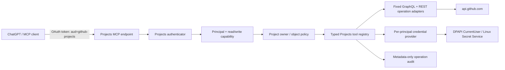

# GitHub のプロジェクト機能を扱う専用 MCP

## 状態と目的

`Issue #94` / `Draft PR #95` の設計案。GitHub のプロジェクト作成・読取り・通常の設定編集、項目と独自欄の管理、公式 API で可能な表示設定の操作を、PC 操作機能から分離した型付き MCP 操作として提供する。これは設計であり、実装・認証情報の設定・GitHub への書き込み検証は未実施。

確定済みの境界は、プロジェクト削除、公開／非公開の変更、参加者や共同作業者のアクセス権変更を RemoteDesktopMCP から行わないこと、課題やプルリクエスト本体の編集をプロジェクト上の項目編集と分けること、任意コマンドや任意 API 要求を公開しないこと。詳細な操作対応は [`Issue #94` の要件整理](../../reports/issue-94-requirements-intake-20261108.md) を正とする。

## 構成

プロジェクト機能は専用の MCP サーバーと接続口を持ち、現行 PC 用 `/mcp` と別のツール一覧・認証対象識別子を使う。例として `/github-projects/mcp` と認証情報内の `aud` 値 `github-projects` を置く。名前は設計上の仮称である。

プロジェクト用 MCP サーバーは `RemoteDesktopService` を作らず、Desktop Commander、`process_*`／`file_*`／転送機能、`shell`、`child_process` 実行器、PC 接続 API を依存に含めない。プロジェクト用 MCP から既知の PC 用ツール名を `tools/call` された場合も接続口と認証の境界で拒否する。ツール一覧から名前を隠すだけでは認可しない。逆に、PC 用の認証対象識別子を持つトークンではプロジェクト用の接続口を通さない。これはプロジェクト接続が PC 操作を行えない保証であり、同じ `dot` 利用者が別の PC 接続を作成できるかどうかは別の認可・製品境界として扱う。

## 利用者識別、認証、認証情報

- HTTP 認証結果を `{ issuer, subject }` を持つ不変の利用者識別情報とし、現行の平坦な `user` 文字列だけを認証情報の識別キーに使わない。RemoteDesktopMCP 利用者一人に GitHub 利用者一人を対応させ、GitHub の不変な数値利用者 ID を保護された設定情報に記録する。別利用者間で認証情報を共有しない。初期は本人一人で、複数アカウント切替画面は作らない。
- プロジェクト用接続口は認証対象識別子 `github-projects` のみを受理する。ツール情報の取得と各 `tools/call` で権限を再検証する。`github-projects:read` は照会、`github-projects:write` は列挙済み更新だけに使い、管理者権限は設けない。プロジェクト用トークンを PC 接続口で、PC 用トークンをプロジェクト用接続口で受理しない。
- 現行の OAuth 認証は PC 用 `/mcp` と権限 `mcp` の組に限られる。プロジェクト用接続口を実装する場合は、既存の認可コード交換・更新・認証時の照合を拡張し、接続先と認証対象の識別値 `aud`、`github-projects:read`／`github-projects:write` の権限を対応させて発行・照合する。更新後も元の接続口と権限を維持し、PC 用トークンとの相互利用を拒否する。この認証拡張は現行コードにはまだない。
- GitHub 認証方式は本人が選択済みの個人 PAT。登録はローカル専用の隠し入力を使うコマンド行操作を候補とし、MCP 引数、チャット、コマンド行、`shell` 履歴、環境変数に PAT を置かない。登録時に固定 `GET /user` で GitHub 利用者 ID を確認してから保存する。登録画面／保管機能は未実装。
- Windows は DPAPI の `CurrentUser`、Ubuntu／Linux は `Secret Service` を OS の保護領域として使い、実行 OS 利用者と保護領域の実行主体を一致させる。PAT 本体を `.env` に置かない。保護領域がない・施錠中・復号不能ならプロジェクト操作を拒否し、平文へ切り替えない。RemoteDesktopMCP の他機能はそのまま利用可能とする。DPAPI の利用者設定とサービス主体の一致、画面のない Linux 環境での鍵解除、複製／移行は実環境で未検証。
- 保護領域の識別名はサーバー管理のアプリ名と RemoteDesktopMCP 利用者 ID から生成する。設定情報にトークン値は含めない。交換時は新 PAT の `/user` を検証し、GitHub 利用者 ID が既存対応と一致した場合だけ置換する。通常利用中は再入力を要求しない。`401` 後も自動更新・削除・再入力要求をせず、書き込みを停止して一度だけ復旧方法を知らせる。`403` は権限／組織方針による拒否として扱い、再設定を促さない。
- PAT の必要な `scope` や `fine-grained`／`classic` の最終設定はこの設計で確定しない。個人 `Project #4` と利用者所有プロジェクトの表示設定 API の対応制約は、権限粒度調査・認証情報の実証を保留している。GitHub PAT の実権限が広くても、サーバー側の許可一覧を越える `GraphQL` 更新や `REST` の経路／本文は公開しない。

## 操作 API と公開範囲

各ツールは一つの意味に固定した入力形式を持ち、返却はプロジェクト用の正規化形式とする。GitHub node ID は意味を解釈しない値として扱い、対象プロジェクト、項目、欄の所属と型をサーバー側で再解決する。利用者入力の GraphQL 文、URL、REST の経路、HTTP の操作方法、任意の通信指定や送信本文を受ける汎用中継機能は設けない。

| 領域 | 専用操作に含める範囲 | 固定 API／制限 |
| --- | --- | --- |
| プロジェクト | 自分が所有するプロジェクトの一覧・詳細読取り、新規作成、題名・短い説明・`readme` の通常編集 | `GraphQL` の照会、`createProjectV2`、`updateProjectV2`。作成時の所有者 ID は認証済み GitHub 利用者から決め、呼出元に任意の所有者や組織を指定させない。プロジェクトを閉じる／再開する操作とリポジトリへの関連付けはこの案では未承認のため除外し、確認まで実装しない |
| 削除・公開設定・権限 | RemoteDesktopMCP のツールなし | `deleteProjectV2`、`public` 変更、共同作業者のアクセス権更新を許可一覧に登録しない。所属組織との関連付け／解除もツール化しない。読取りに公開状態が含まれても更新入力には含めない |
| 項目 | プロジェクトへの課題やプルリクエストの追加・読取り・欄の値更新・順序移動・保管、保管解除、またはプロジェクト項目の関連解除。プロジェクト内の下書き課題の作成・編集 | 固定 `GraphQL` 操作。`project_item_remove` は項目と課題やプルリクエストの関連を外すだけで、本体を削除しない。本体の題名・本文・`labels`・担当者・`milestone`・`state` 等を変更するツールは作らない。`draft-to-Issue conversion` は課題本体を新設するため未承認として除外 |
| 独自欄 | 欄の定義一覧・作成・名称／選択肢／期間設定の編集・削除、および項目の値の取得・更新・消去 | `createProjectV2Field`、`updateProjectV2Field`、`deleteProjectV2Field`、欄の値を扱う固定更新処理。選択肢更新では既存 ID を保ち、読み取った時点で変更対象外の選択肢・期間定義を保持する。欄／選択肢削除で既存項目の値が失われ得ることを結果に明示する。項目値の設定・消去は対象プロジェクトの許可済み独自欄に限り、`labels`、担当者、`milestone` 等の課題本体由来の値は変更しない。 |
| 状態／優先度 | 現在のプロジェクト欄と選択肢の読取り／書き込み | `Status`／`Priority` を GitHub 組み込み機能と仮定しない。欄名・型・選択肢 ID は対象プロジェクトから取得し、名前だけで曖昧一致更新しない。項目の位置／順序は優先度欄の値と別操作 |
| 表示設定 | 表示設定の一覧・詳細読取り、作成、公式 API が受け付ける範囲の更新、削除 | `GraphQL` で表示設定の照会・作成・更新・削除。`REST` の `POST .../projectsV2/{project_number}/views` は `table`／`board`／`roadmap`、絞り込み、表示欄、並び替え、分類／縦方向の分類を指定した作成を文書化。`GraphQL` 更新入力には `name`／`layout`／`filter`／`visible field configuration` はあるが、`sort`／`group` の更新項目はない。公式 `REST` 資料で利用者所有プロジェクトの更新口は確認できていないため、並び替えや分類の後続変更は対応済みと約束しない |
| その他の機能 | 今回の公開ツールには含めない | プロジェクトの状態更新、作業手順やひな型の管理、分析や図表表示などは GitHub のプロジェクト画面全体の完全な再現を目的に今回追加しない。別途要件確定後に API 対応範囲を確認する |

表示設定 API の出典は [REST の表示設定](https://docs.github.com/en/rest/projects/views)、定義操作は [GraphQL のスキーマ](https://docs.github.com/en/graphql/reference/projects)。公式 API はプロジェクト作成時に `teamId`、更新時に `public`／`closed`、共同作業者の更新、プロジェクト削除等を提供するが、存在する更新処理をそのまま公開しない。作成時に組織のアクセス権が混ざらないよう `teamId` を必ず省く。

## 更新処理、監査、競合、障害

1. MCP 接続口と認証対象識別子／`scope` を認証し、RemoteDesktopMCP 利用者と GitHub 利用者の対応を読む。
2. ツールの入力形式を検証し、権限（読取り／書き込み）、プロジェクト所有者、項目／欄／表示設定の所属・型を確認する。所有者は登録済み GitHub 利用者のみとする。
3. 更新前に限定された操作情報を監査記録へ予約し、プロジェクト操作自体の取消状態を確認してから、登録済みの処理 ID に対応する単一の固定 API 呼び出しを送る。PC 用の緊急停止状態との共有は初回利用の条件としない。
4. GitHub の応答を正規化し、HTTP 200 だけで成功と判定しない。GraphQL `errors` がある場合は成功扱いせず、期待する更新結果を確認する。403／429 や GraphQL の呼出し回数制限エラーは、応答本文と応答ヘッダーから判別できる場合に権限拒否と利用制限を分ける。送信後に適用の有無が不明なら `applied="unknown"` とし、自動再試行しない。可能な操作は再読取りで対象値を確認してから適用済みを返す。生の `GraphQL` エラー、`REST` 応答本文、HTTP 認証ヘッダー、PAT、課題やプルリクエスト本文、下書き本文は監査記録やエラー情報に保存しない。

`clientMutationId` は要求の対応付け用であり、再実行しても一度しか適用されないことや、元に戻せることを保証しない。送信前に拒否した場合は `applied=false`、送信後に時間切れ／接続断で結果を確定できない場合は `applied="unknown"` とし、自動再試行を行わない。結果不明時は現在状態を読み直し、その後の再操作は利用者が判断する。独自の再送結果記録は本人の必須要件と確認できていないため、初回利用の条件にしない。GitHub API の更新処理は一連の変更として原子的には実行されない。

同一プロセス内では `(principal, projectId)` 単位で更新を直列化し、選択肢・期間設定の全配列置換前に現在の定義を取得し、変更対象外の定義と ID を保って更新する。これは読み取った時点の値を保持するもので、読み取り後に GitHub 画面や別 RemoteDesktopMCP 実行単位から行われた更新との競合は防がない。再読取りで更新後の状態を確認できるが、分散排他制御／条件付き更新による競合防止は保証しない。

監査記録は `operationId`、RemoteDesktopMCP 利用者、ツール名、プロジェクト、項目、欄、表示設定 ID、API 処理の識別子、開始／終了時刻、HTTP／GraphQL 状態、GitHub 要求 ID、適用状態を記録する。入力値、トークン、本文は記録しない。利用者向けエラーは固定の識別子と簡潔な分類にし、生の API エラーを返さない。監査記録の永続化は既存 PC の機能に依存させない。既存の PC 向け緊急停止との共有は初回利用の条件にしない。

## 検証と実装前に残す判断

実装前の契約試験は API 呼び出し部品の模擬実装で、固定操作一覧、利用者／権限／所有者／対象の対応、認証対象不一致の拒否、直接呼び出しによる PC ツールの利用拒否、欄と値の型、複数回に分けた取得、`401`／`403`、呼出し回数制限、監査記録の秘匿、時間切れ後の結果不明と再試行なし、再読取り、Windows／Linux の認証情報保護領域が使えない場合の拒否を確認する。実 PAT 作成、権限設定、`Project #4` への書き込み／再読取りはここでは実行せず、認証情報／権限変更は個別承認と検証環境が揃うまで保留する。

本人確認が必要な境界は以下のとおり。ここを実装者が黙って推測してはならない。

- プロジェクト作成／読取り／設定編集を本人所有の個人プロジェクト（`Project #4` と本人が作るもの）に限定する方針でよいか。組織プロジェクトは今回含めていない。
- プロジェクトの終了／再開とリポジトリとの関連付けは「通常編集」に含めるか。現案は未承認として除外。
- 項目の除去／保管、下書き課題の作成／編集、欄／選択肢／期間設定の削除を許可する境界は上記のとおりでよいか。下書きから課題への変換は課題本体の作成を伴うため除外した。
- 表示設定の並べ替え／分類は作成時の `REST` 設定だけを対応とし、公式 API 資料で更新方法を確認できない場合は RemoteDesktopMCP から再編集できない扱いでよいか。
- PC 向け緊急停止との共有は本人の必須要件と確認できていないため、初回利用の条件にしない。送信後の更新は GitHub 側で取消保証がない。
- 「PC を操作しない」保証はプロジェクト用接続口が公開する機能に限定し、同じ `dot` 利用者が別の PC 接続を使える可能性は別に扱ってよいか。

この文書で未確定の項目を閉じるか実装へ進むかは、本人の次の確認を待つ。GHP-02〜05（認証実装、プロジェクト API 実装、認証情報設定、実運用検証）はこの承認だけでは開始しない。
